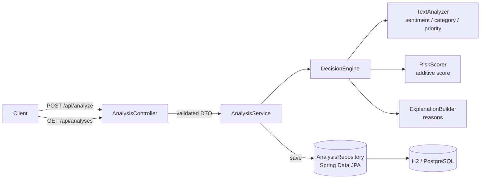

# AI Decision Simulator

[](https://github.com/nobrerafael521-svg/ai-decision-simulator/actions/workflows/ci.yml)


An **explainable decision engine** for customer messages. It receives free text, detects sentiment, category and
priority, computes a risk level, recommends an action (`auto_reply`, `review_case`, `escalate_to_human`) and returns
the **reasons** behind the decision. Every analysis is persisted via Spring Data JPA (H2 by default, PostgreSQL in
production) and can be queried through a paginated REST API.

The engine is deliberately **rule-based and deterministic**: in support and compliance scenarios, a decision you can
explain and test beats a black box.

## Architecture



| Layer | Responsibility |
|---|---|
| `controller` | REST endpoints, request validation (`@Valid`), pagination limits |
| `service` | Transactions, orchestration, mapping to DTOs |
| `engine` / `nlp` / `scoring` / `explain` | Pure decision logic, no framework state, unit-tested in isolation |
| `model` / `repository` | JPA entity (`analyses`, `analysis_explanations`) with indexes on `risk_level` and `created_at` |
| `exception` | `@RestControllerAdvice` returning RFC 7807 `ProblemDetail` responses |

### Risk model

`score = 2 (negative sentiment) + 2 (high priority) | 1 (medium priority) + 2 (risk keyword: cancelar, advogado, tribunal, reclamação, fraude, urgente)`

| Score | Risk |
|---|---|
| >= 5 | `high` |
| 3-4 | `medium` |
| < 3 | `low` |

Action: `high` risk or `high` priority -> `escalate_to_human`; category `complaint` -> `review_case`; otherwise `auto_reply`.
Keywords are Portuguese; matching of short words (`já`, `mau`, `bom`) is whole-word to avoid false positives.

## REST API

| Method | Path | Description | Success |
|---|---|---|---|
| `POST` | `/api/analyze` | Analyse a message and store the result | `201` |
| `GET` | `/api/analyses?riskLevel=&page=&size=` | Paginated history (newest first, `size` capped at 100) | `200` |
| `GET` | `/api/analyses/{id}` | One stored analysis | `200` / `404` |
| `GET` | `/actuator/health` | Health check | `200` |

Errors use RFC 7807 (`application/problem+json`); validation errors include a field map under `errors`.

```bash
curl -s -X POST http://localhost:8080/api/analyze \
  -H 'Content-Type: application/json' \
  -d '{"text": "Quero cancelar urgente, vou falar com o advogado"}'
```

```json
{
  "id": 1,
  "text": "Quero cancelar urgente, vou falar com o advogado",
  "sentiment": "negative",
  "riskLevel": "high",
  "priority": "high",
  "category": "complaint",
  "recommendedAction": "escalate_to_human",
  "explanation": [
    "sentiment detected: negative",
    "category detected: complaint",
    "priority detected: high",
    "risk calculated: high",
    "keyword detected: cancelar",
    "urgent language detected"
  ],
  "createdAt": "2026-01-01T12:00:00Z"
}
```

```bash
curl -s 'http://localhost:8080/api/analyses?riskLevel=high&page=0&size=10'
curl -s http://localhost:8080/api/analyses/1
curl -s -X POST http://localhost:8080/api/analyze -H 'Content-Type: application/json' -d '{"text": ""}'   # 400
```

## Run it

**Requirements:** JDK 17+ and Maven 3.9+ (or Docker).

```bash
# Local, H2 file database in ./data
mvn spring-boot:run

# Tests (unit + MockMvc integration tests on in-memory H2)
mvn verify
```

**Docker + PostgreSQL (Linux/macOS/WSL):**

```bash
cp .env.example .env        # set DB_PASSWORD
docker compose up --build   # API on http://localhost:8080
```

### Configuration

| Property / env var | Default | Purpose |
|---|---|---|
| `SPRING_PROFILES_ACTIVE=postgres` | (H2) | Use PostgreSQL |
| `DB_URL`, `DB_USER`, `DB_PASSWORD` | `jdbc:postgresql://localhost:5432/simulator`, `simulator`, none | PostgreSQL connection |
| `app.cors.allowed-origins` | `http://localhost:3000,http://localhost:5173` | CORS allow-list for `/api/**` |

## Tests

26 tests: parameterised unit tests for the analyser, scorer and engine, plus `MockMvc` integration tests covering
creation, validation (blank / oversized text), filtering, pagination and `404` handling.

## Stack

Java 17, Spring Boot 3.3 (Web, Validation, Data JPA, Actuator), H2, PostgreSQL, JUnit 5, MockMvc, Maven, Docker, GitHub Actions.

## Possible next steps

Flyway migrations instead of `ddl-auto: update`, OpenAPI docs (springdoc), authentication, pluggable ML-based analyser behind the same interface.

## License

[MIT](LICENSE)
